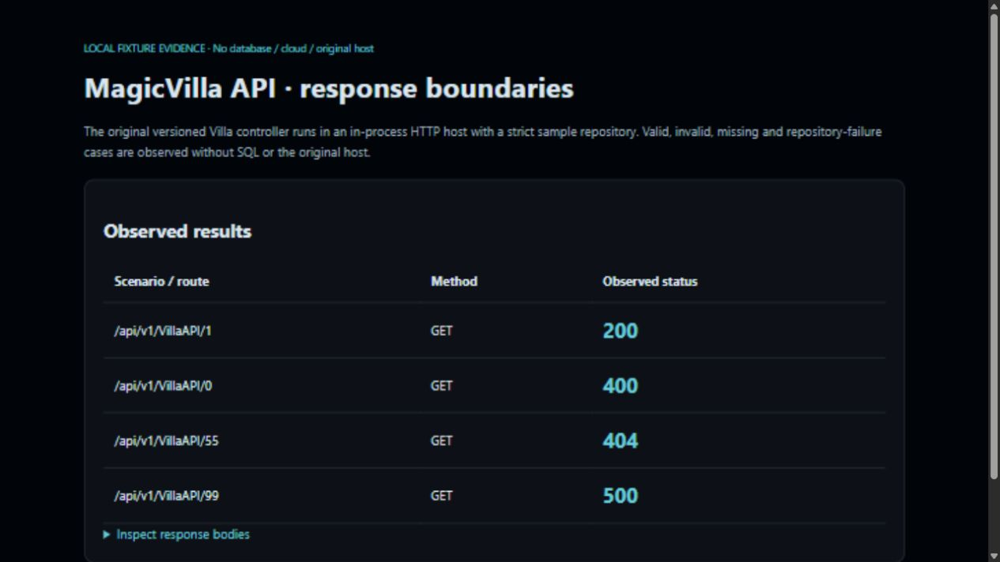

# MagicVilla · Early API · captured evidence

The existing versioned Villa controller with a strict fixture repository: valid 200, invalid ID 400, missing 404 and sanitized repository failure 500.



## Reproduce locally

Requires .NET 10 SDK and NuGet access. From the repository root:

```powershell
dotnet restore tools/Preview/Preview.csproj
dotnet build tools/Preview/Preview.csproj --configuration Release --no-restore
dotnet run --project tools/Preview/Preview.csproj --configuration Release --no-build --no-launch-profile
```

Open `http://127.0.0.1:8843/`; stop with Ctrl+C. The helper binds only to loopback and clears its configuration sources. It does not invoke the original application entry point, register a DbContext, run migrations or call providers. `/preview-info` describes the isolation. All non-GET methods return 405. Unsupported application routes return 404.

`/evidence.json` exposes observed results. The API fixtures execute real endpoints/controllers in TestServer with strict sample repositories; no signing key or token is displayed. The Azure preview directly calls the existing pure image transform and never starts Azure Functions.

## Evidence boundary

Captured on 2026-10-28 from the checked-in implementation and clearly marked sample inputs. Animated media concatenates actual captured UI states with readable dwell times; it does not simulate a completed transaction. No production, cloud, database, payment, identity or email operation is implied. Static PNG is available above for reduced motion.
